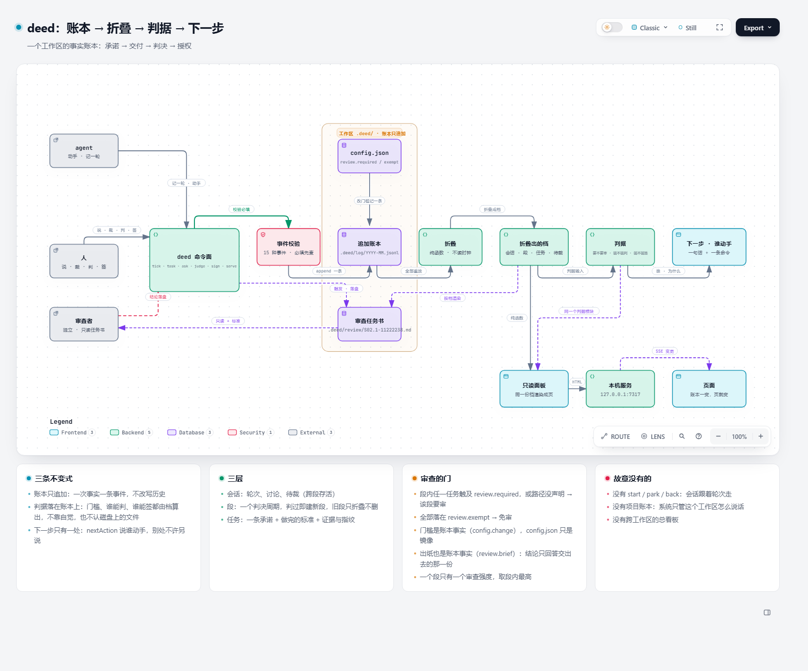

# deed

一个工作区的放行协议：**谁有资格说「这件事过去了」、要凭什么、下一步谁动。**

留下来的只有记录（一次动作一行，只追加），但产品不是这些记录——是记录之上那套会拒绝人的规则：没写标准不开工，没经过审查不算做完，交付过这件事的人不能判它，记录对不上就不算过去。放不过，一个字都不落。

**编排器决定 agent 干什么；deed 决定人敢不敢放行。**



大图是 [`docs/deed-architecture.html`](docs/deed-architecture.html)（单文件、离线、可交互），由同目录的 `deed-architecture.candidate.json` 重出；改图的规矩见 [`docs/README.md`](docs/README.md)。

## 它是什么

- **一份只能追加的记录**：`.deed/log/*.jsonl`。一次动作一行；打回、作废、改审查设置也是行，没有删除。
- **一套从记录里算出来的规则**：`core/fold.mjs` 折出会话与段，`core/rules.mjs` 算「要不要审、能不能判、能不能签、下一步是谁」。状态不手写，没有第二份草稿，也不读时钟。
- **一次动作只有一处入口**：每个动词先重放一遍账本，放不过就什么都不写——「先写进去再崩」不会发生。
- **结论记在那一份字节上**：审查清单是唯一交到账本外、又要给别人看的文件；发出去时记下路径与 sha256，结论只能回答发出去的那一份。

它不接管 CI、issue tracker 或 PR 流程，也不解析它们的格式。它回答的是另一类问题：这个工作区里，一次动作有没有留下可核的记录，现在凭什么可以放行。

## 装

Node ≥ 22，纯 ESM，零依赖，还没有 npm 包（名字没定）。

```bash
git clone <this> deed && cd deed
node cli/deed.mjs help      # 就地可用
npm link                    # 之后在任意目录敲 deed
npm test                    # 204 条，两分钟左右（每条都起真进程）
```

vendor、本地 tarball、升级与卸载见 [`docs/INSTALL.md`](docs/INSTALL.md)。

## 接进一个工作区

`deed` 把当前目录当作工作区，产物只落在 `<工作区>/.deed/`；`init` 不写你的 `AGENTS.md`、不改 `.gitignore`、不装钩子。

```bash
cd /path/to/your/repo
deed init --review "core/**,cli/**" --exempt "docs/**,*.md"
```

审查设置里写的是**你这个工作区**的目录名。deed 不替你猜 `src/`、`app/` 这类名字：什么都不声明，就全部要审。

它建三样：`.deed/config.json`（审查设置与端口）、`.deed/log/`（账本）、`.deed/review/`（审查清单与角色包）；
第一次交付时再加 `.deed/workspace.json`（上一次交付的内容指纹，用来算「这一交付实际动了哪些路径」）。

审查设置不是冻住的：`deed init --force --exempt "docs/**" --why "为什么改"` 改得动，`--why` 必填，改动进账本。
**那个文件是镜像不是事实源**：规则读的是账本里的审查设置，手改 `.deed/config.json` 不改任何判断，`deed verify` 会报「审查设置对不上」。

接完在宿主的规则文件里粘一段，让下一位 agent 知道规矩。`deed init --print-agents` 打印的就是下面这段，
原样粘进 `AGENTS.md`（或 `CLAUDE.md`）：deed 不替你写那个文件，它属于管理这个仓库的人。
没粘不报错，但 `deed doctor` 每次都会提一句「接入 · …」，面板顶上挂着同一句，直到有人写进去。

```md
## 治理
- 用户每说一轮先 `deed tick --said "…"`（`--who` 只认 user，自开一轮会被拒）；会话跟着轮次自己开合，不用手动建。你自己的进展不记成轮次：写进交付记录（`deed submit`）或结论（`deed review`）。
- 要做什么先 `deed plan`：从账本出一份清单草稿 `.deed/plan.md`（每段的任务、标准、交付记录）。在文件里加条目、写标准，改完 `deed submit` 一次记账；整批原子——有一行不合格，一个字都不落。清单里可以写好几节 `## 段`：一节就是一个段，空标题的那一节 submit 时领号、排在后面；只有收活的那一段能交付，前一段判过它才接过活。
- 清单上的写法：`- ? 标题` + 一行 `  标准：` = 新条目（submit 领号）；`- [x] T1 标题` + 一行 `  交付：跑了什么、结果几比几` = 交付；把它改回 `- [ ]` + `  理由：` = 撤回最后那条交付；`~~ T3 标题` + `  理由：` = 放弃；`  延后：什么时候` = 延后；`  改到下一段：原因` = 这条没做的落到下一段（清单里排好的那一节；没排就先加一节，否则会被拒）。说错了话就把勾去掉，别把话说圆。
- 清单上已有的条目改了标题或标准会被整批拒：还没有 amend，改就是开一条新条目，旧的留着。新条目不能在同一次里勾上交：任务要先记账，做完再勾。
- 拿不准就问 `deed ask "…" --reading "我理解成…" --why "为什么得你定"`，只有用户能 `ask resolve`。裁定里能带两行：`边界：…`（以后不许这么干）与 `弃：…`（这件事不做了）——它们不进清单，跟着那句话留在这期的账里。
- `deed state` 只说下一步是谁；照着做，不要自己另排优先级。
- 这一期要做成什么，写一句：`deed goal "要做成的样子" --by "谁"`；可以改，旧的那句留在历史里。签收拿它当尺子。
- 要审的段：`deed review --segment S0x.N` 出清单与角色包——清单（审什么）与角色包（怎么审），记一条 `review.brief`，不写结论；结论要求这一段已经全部交付（还有未做的会被拒）。
- 只有发出去过的清单才能被回答：没发过清单就落结论会被拒；发出去之后那两份字节被改过、或文件不在了，结论也落不下来（`deed review --segment S0x.N` 另出一份，旧的那条记录留着让 `verify` 报）。
- 结论记的是发出去那一刻两份的 sha256（`briefDigest`+`guideDigest`），不是落结论时现写的一份；`deed verify` 会重算核对。
- 审查者判的是「这一段通不通过」：`deed review --segment S0x.N --by 「谁」 --verdict pass --result T1=met`（每条标准一个判定；`--result-all met` 是省写）通过之后这一段**还在**，它被交回给你——判过之后这一段的结局才落下来（在面板上按「判决通过」）。判不通过要 `--verdict fail --rework T1,T2 --why 「为什么」`：被点名的条目回到未做，其余保持交付，这一段不关闭。判过的条目下一份清单不再要人重判。
- 清单发出去、还没人回答的这段时间，这一段冻结：交付与撤回交付不收（新活落进下一段）；记轮次、写题、放弃、改到下一段照旧。要改这一段的活就先撤回这份清单：`deed review --segment S0x.N --withdraw --why 「为什么」 --by 「谁」`。
- 审查分两层，判决在中间：审查者的 pass 只是把这一段交回来，你在面板上按「判决通过」这一段才关闭（免审段由 `deed seal` 关）；各段都判过之后，这一期做成的样子还要有人审——`deed review --all` 是期审，判的是目的与各段之间说不说得通，不重判段里的条目。期审通过才轮到你签收。段审一直用同一双手（清单交给谁，结论由谁落）；期审每次都换一双手。
- 人只在面板上出手：在验收屏写下原话按「签收这一期」（`deed sign` 在命令行上只回一句「去面板上按」，不记账——账本要读得出是人按的：`by` 与 `via: panel`）。审查的结论不归你改：判错了由审查机制自己回答。
- 审查设置说这一段不用审（改动只落在免审路径）：`deed seal --why 「凭什么不审」` 关闭这一段。它不是结论，签收时这一段会被列成「没经过审查」。一段的结局只由审查者的结论落；`sign` 在命令行上只回一句「去面板上按」，不记账。
- 身份是约定不是鉴权：`--by`、`who` 记的是自述，账本保证「谁说过什么」可回溯，不保证「说的人是谁」；它能做的只有一件事——不替任何动作填名字。
- 在清单里勾上时不用挑文件：`submit` 按工作区快照前后差自己算碰了哪些文件、各是什么 sha256。要手工挑着记下才用 `deed task done <T> --evidence "…" --digest <文件>`（几份写几遍）；没记下文件的交付仍在账本里，但会挡住要审段的放行。
- 交付记录里的数字要在你要交的那份字节上跑出来：`deed submit --run <命令>` 真跑一遍，条数由工具采进账本，记录里那一对数字与它不一致整批拒。说得出现象的配一行 `期望：<命令> => 要看到的话`，记账前真跑；跑不出来就是假记录；两样都没配的，清单上标成「只是说法」，不算可核的事实。
- 查：`deed verify`（交付记录与 sha256）、`deed doctor`（账本能否重放；另报「先做后记」几条——文件在那条任务被记下之前就已经写好）、面板（跟着命令自己起，`deed panel` 看它在不在）。

没有落进账本的动作不算发生过；状态是推出来的，不用手写。
```
## 一段的走法

七步，每一步只落一件事实，落不下来就一步也走不动：

| # | 谁敲 | 落下什么 |
| --- | --- | --- |
| 1 | `deed tick` | `turn`：谁在第几轮说了什么 |
| 2 | `deed plan` → `deed submit` | `task.add`：一件要做的事 + 做完的标准（清单上 `- ? 标题` + `标准：`） |
| 3 | `deed submit` | `task.done`：交付记录 + 由工作区快照算出的文件 sha256（清单上勾上并写 `交付：`） |
| 4 | `deed review` | `review.brief`：发清单与角色包，记两条路径、两个 sha256 |
| 5 | `deed review --verdict` | `review.log`：结论只回答交出去的那两份；pass 把这一段交回给用户（还不关闭），fail 点名退回 |
| 6 | —— | `review.overturn` 已删（含义第 22 版起不写新行）；旧账本里那一行照读成历史 |
| 7 | 面板「签收」 | `sign`：结束这一期（命令行不给这条路） |

## 每一步谁动手

`core/rules.mjs` 的 `nextAction()` 是唯一出处，顺序固定：

1. 还没有会话 → agent 记第一轮
2. 有待裁 → **用户**裁定
3. 一个段都没开 → agent 开段（写第一条任务）
4. 有没做完的任务 → agent 继续
5. 审查者出结论（pass 交回给你判，fail 点名退回）→ 人按「判决通过」，这一段才关闭
6. 审查者判了不合格 → 被点名的条目回未做，改完再交
7. 都封好了 → **用户**签收

## 它拒绝什么

每个动作先试折、后落盘：折不过就一个字都不写。下面这些是「报错，账本不变」：

| 想做什么 | 会被谁挡住 |
| --- | --- |
| 在已封存的段里改任务、补审查、再判 | `fold`（封过的段就是结局：要改就开新一期把要补的记进去） |
| 打回不在这个段里的任务 | `fold`（打回不能跨段） |
| 审查判了不合格还想判过 | `fold`（被点名的先重新交付） |
| 任务 id／待裁 id 撞名 | `fold`（T 与 A 共用命名空间） |
| 没写 `交付：` 就勾上 | `submit`（整批拒，一个字都不落） |
| 签收时还有没结清的、还有待裁 | `fold` 与 `signBlockers` |
| 记下的文件已经变了 | `deed verify`（重算 sha256），要审的段判决前也查 |
| 交付记录只说了做了什么，没记任何文件 | `deed verify`（单列一档，不混在过期里）；面板的签收闸（签收前必须记下一个文件） |
| `--digest` 指到工作区外面、或指一个目录 | `task done`／`submit`（只认工作区里的普通文件） |
| 清单上已有的条目改了标题或标准 | `submit`（还没有 amend：改就是开新条目，旧的留着） |
| 清单上少了一条、又没有 `~~` | `submit`（整批拒：少一条只能是有人写了不做） |
| 改审查设置却不说为什么 | `init`（`--why` 必填，改动进账本） |
| 手改 `.deed/config.json` 而不收进账本 | `deed verify`（「审查设置对不上」，exit 1；规则根本不读那个文件） |
| 清单或角色包被改过、丢了、或账本没记它的指纹 | `deed verify`（重算 sha256；exit 1，修法是另出一份再审） |
| 没发过清单就落结论 | `review`（结论只能回答交出去过的那两份） |
| `.deed/review/` 里躺着一份账本没记过的清单 | `deed verify`（「没人认领」；手写的读它不算数） |
| 交付者自己判这一段 | `fold`（同一个人不能判自己交付的段；不同 `--by` 放行） |
| 判决／签收从管道里跑却不写 `--by` | `seal`／`review`（账本不替任何动作填名字） |
| 账本比手上的 deed 新（读不懂的事件类型） | `doctor`／`state`／`verify`／面板（说清写者版本，别挪走：升级就能读） |
## 三条命令 + 一页

```bash
deed verify      # 重算交付记录、清单与审查设置。记录报「路径越界」「记录过期」「没记文件」，清单报「越界」「对不上」「不在了」「没人发过」「没人认领」，审查设置报「对不上」；有坏的就 exit 1
deed doctor      # 逐行校验账本；坏了报哪一行哪一条，并给出唯一人工修法。顺带两行：接入（规则文件里有没有 deed state）、心跳（认得的宿主配置里跑不跑 deed tick，账本最后一条是几点的）
deed gate        # 按账本里的审查设置顺序跑门命令，第一条不过就停，报名字与退出码
deed panel       # 面板在不在；不在就用后台进程拉起来，URL 打在这里（账本一变页面自己变）
deed serve       # 前台版：固定端口 7317，Ctrl+C 就停
```

页面是纯函数渲染：同一份账本、同一个时区参数永远渲染出同样的字节，不读时钟、不读网络、不带外部资源。
账本有一行读不动时页面不消失：GET / 回 500 一张说明页，`/state` 回 `{ "broken": … }`，已连着的页面收到 `event: broken`。

`心跳` 是 deed 唯一读本机时钟的地方：它说「账本最后一条 11-23 04:49（2 小时前）」，只说差值、不说好坏。
钩子装没装是硬事实，账本多久没动只是提示。**账本比手上的 deed 新**时那一行是有效事实、只是读不懂：
`doctor`／`state`／`verify`／面板都说「升级 deed 就能读」，别删也别挪，挪走就是把人写下的真事当垃圾。
每行都记着写它的版本（`w`），所以这句话有据可依。

## 它站在哪一格

**层**：它不新开一层，它是既有「过程记录层」里最后一格的载体替换。那一格是**授权**：谁判的、判的是哪一份字节、判过之后改动是否作废。
今天这一格没有主人：它散在 PR 审批、会议、邮件、口头决定里，而这些不能被重算，也不能被拒绝。

「谁提过（intent）／做到哪（progress）／谁定的（decision）／谁准的（authorization）」四格里，前三格各有归处
（issue tracker、ADR 与规格、PR 审批），deed 只认领第四格，并把它和前两格记在一起：**任务 → 交付 → 判决 → 授权**。

同一件事别人也在做，所以先把话替质疑者说了：

| 系统 | 有哪几件 | 差在哪一步 |
| --- | --- | --- |
| **Gerrit** | 四件齐全：票绑 patch set（"Votes that are not copied to the new patch set, are called outdated"）、`ignoreSelfApproval`、submit requirements 谓词求值、Attention Set 算「现在谁该动」 | 真相在服务端数据库；对象是 diff 不是交付物；没有签收；离线不可用 |
| **GitHub 保护分支** | stale approval、`approval from someone other than the last person to push`、CODEOWNERS | 账在平台；粒度是 PR；dismiss stale approvals 是可选开关；没有签收；离线不可用 |
| **Fossil** | 同构最强：票据变更即 artifact、当前状态 = 重放、内容寻址 | 票据的「当前状态」是它自己的私事，不回答「谁能判、下一步谁动」 |
| **NIST SP 800-53 CM-3** | 变更控制记录四件（申请／评估／批准／实施） | 记录在 GRC 里、靠开会推进、不可重算、不随代码走 |
| **21 CFR Part 11** | 11.10(e) 不可擦除、11.10(f) 顺序强制、11.70 签名必须与电子记录绑定 | 是法规不是工具；deed 不声称合规 |
| **in-toto / SLSA** | 证明的形态逐条对上：`subject[{name,digest}]`，"matched purely by digest" | 管供应链，不产「下一步」；没有判决与签收 |
| **Beads** | 形态最像：git、离线、纯数据 | Compaction 会改写历史；已把真相从 JSONL 迁到 Dolt |
| **git-appraise** | 评审即 git 对象、离线（Google，已归档） | 无状态投影、无「这一份」绑定、无下一步 |
| **cc-sdd** | 独立 implementer + 独立 reviewer | 判决是 `tasks.md` 里的字符串：审的是当前工作区，判决没有对象 |
| **OpenSpec / Spec Kit** | 规格、任务、阶段关卡 | 真相是一份可反复改写的人维护文档；完成 = 文档里的勾；历史交给 git |
| **acc / agent-change-control** | four-eyes、离线、digest、stale approval | 真相是 API 快照（自述 "best-effort snapshot, not an atomic historical archive"）；没有「结论绑定交出去那一份」 |

一句话分界：规格工具告诉 agent 该造什么；deed 记下交出去的是哪一份、谁判的、接下来谁动。
更细的出处与三条反驳（票据换存储／流程引擎子集／CI gate）见 [`docs/research.md`](docs/research.md)。

**不声称的事**（说清楚比藏起来便宜）：

- **不防篡改**：账本随仓库走，有 push 权限的人能重写历史并让它自洽；`--by` 是自述不是鉴权。deed 给的是协作纪律，可追的是「谁说过什么」，不是「说的人是谁」。
- **不声称合规**：不提供认证、不做保留期、不是电子签名法规意义上的签名。
- **不是新层，也不是平台**：层成熟度 3/5，缺平台默认与中立规范。最先被替代的是手写的 `HANDOFF.md`：读者是 agent，只关心「下一步是什么」，正好是 `deed state` 的第一行。
- **不派活、不鉴权、不多工作区**：派活是宿主能力，接不上就由 `doctor` 说「派活未接」；不建账号、不签发证书；一份账本一个工作区。
- **审查会退化成盖章**：所以可复算的交给确定性校验（`verify`／`fold`），人的判断只留风险取舍。

## 目录

```
core/             纯函数层：事件形状、重放、规则、指纹
lib/              适配层：账本文件与锁、时间格式、宿主规则文件、版本、心跳
cli/              命令面：每个动作先折后写、审查清单与角色包、账本与工作区的核对
board/            本机只读面板：账本 → 一页 HTML（纯函数）+ 服务与 SSE
test/             每条都起真进程；support/lib.mjs 造临时工作区
docs/             DESIGN（行为权威）、INSTALL、架构图、research，索引见 docs/README.md
examples/         示例账本 + 重放脚本（node examples/rebuild.mjs）
HANDOFF.md        现状、下一步、没做的
```

## 已知代价

- **单工作区**：一屏只回答「这个工作区现在到哪一步」，跨项目汇总故意不做。
- **并发靠一把文件锁**：两个进程排队最多等 10 秒；锁里写着持有者 pid 与开始时间，凭 pid 判活（进程还在就等，没了立刻接手）。
- **账本坏了不自愈**：追加写不修历史；一条读不懂的行，先判断是不是「账本比 deed 新」，不是才挪进 `.deed/log/rejected/`。
- **记录会过期**：`deed verify` 重算指纹，改了代码不重跑就报「交付记录过期」；它不会自动跑。
- **缺一条观测通道**：账本说「判过了」，但没人常规核对工作区现在还是不是那一份（`verify` 是雏形）。
- **单文件命令面**：手写解析，没有自动补全；参数错了就报错。